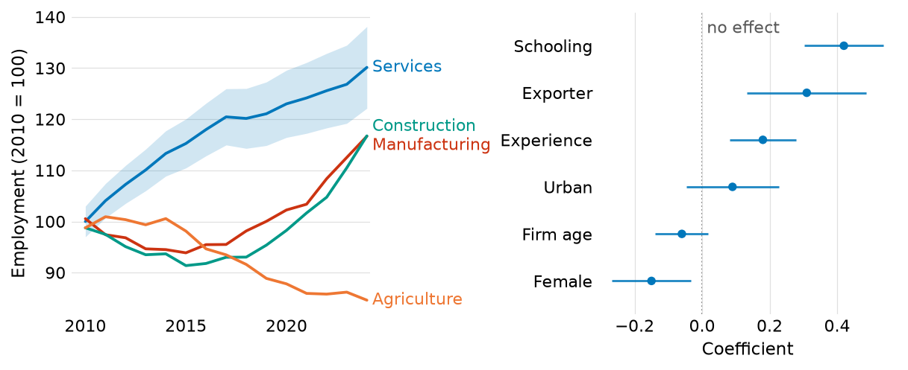
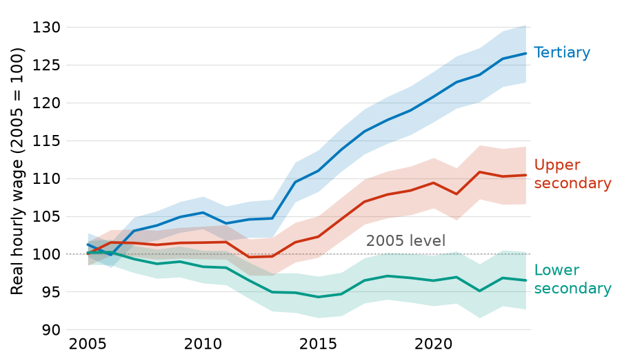
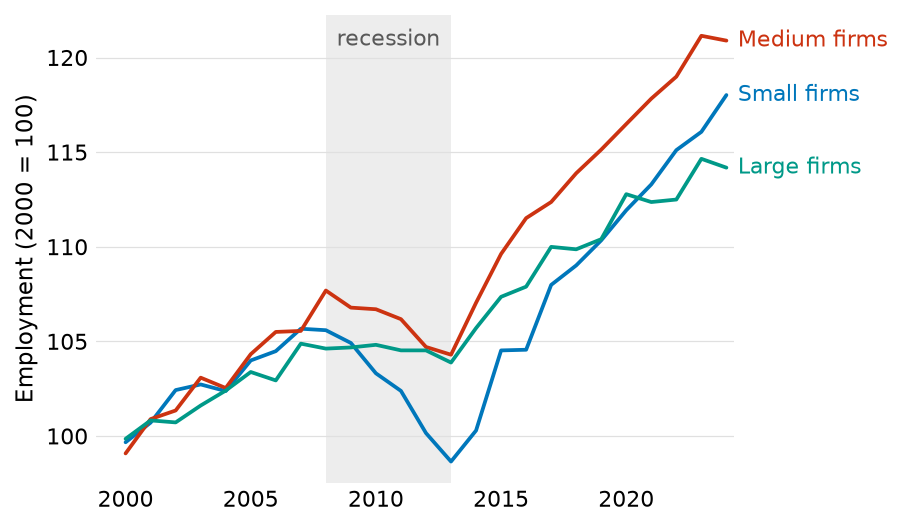
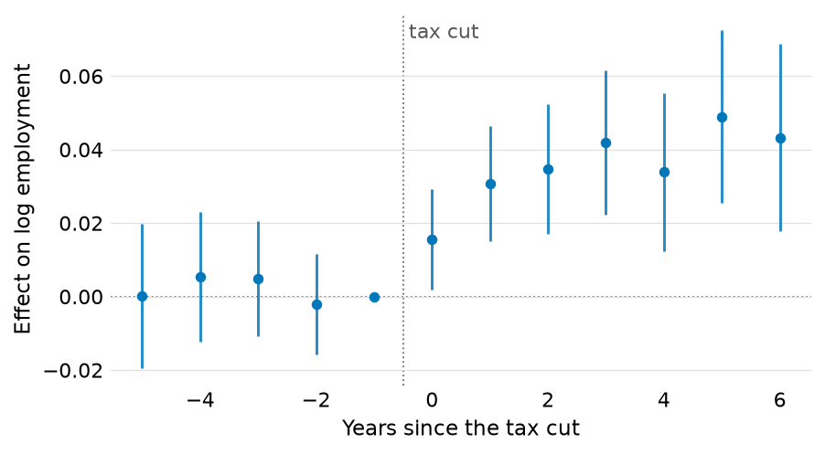
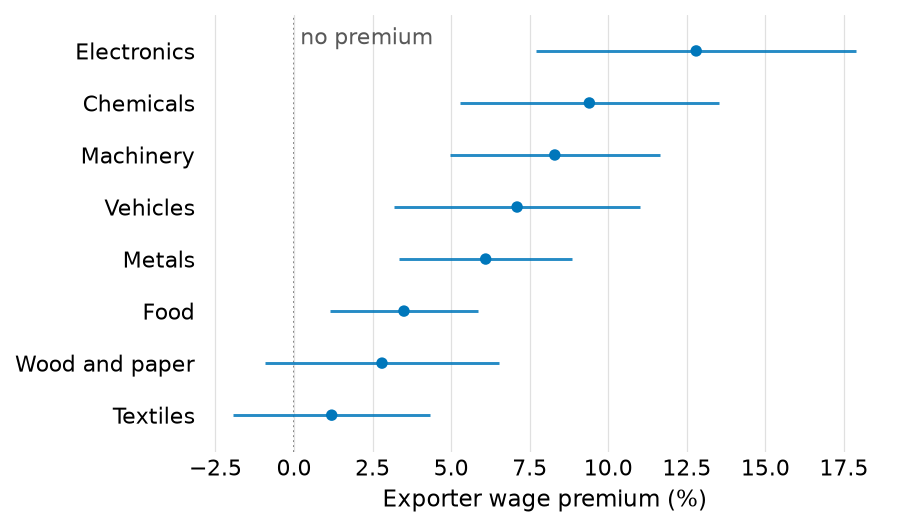
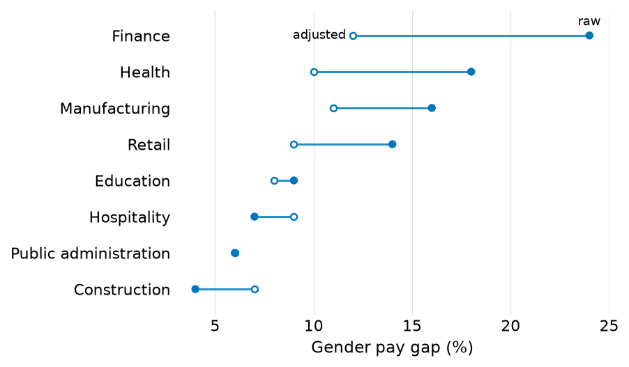
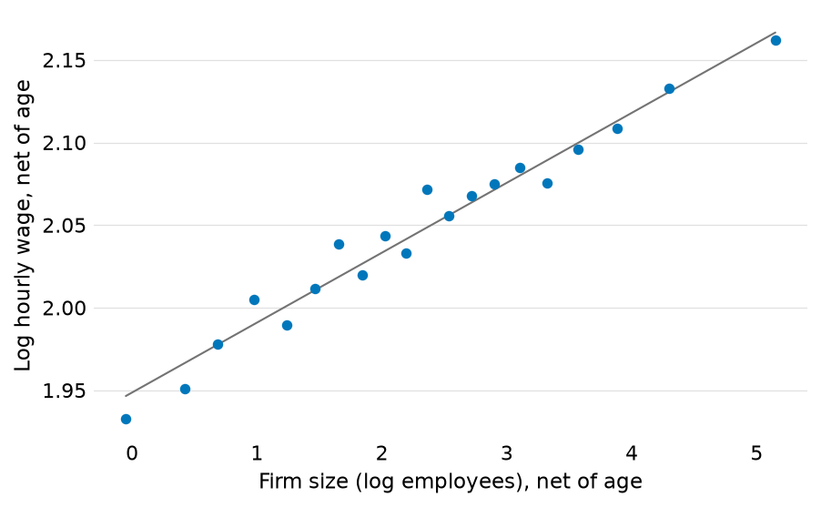
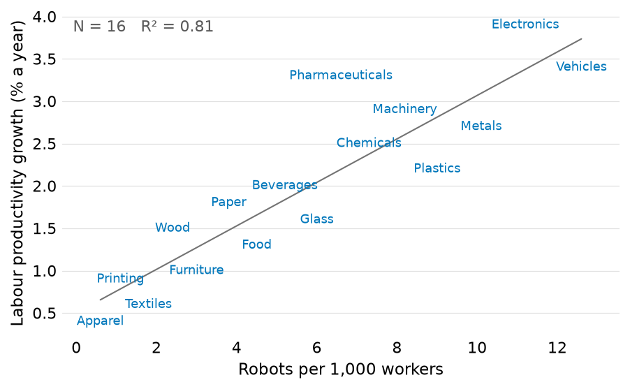
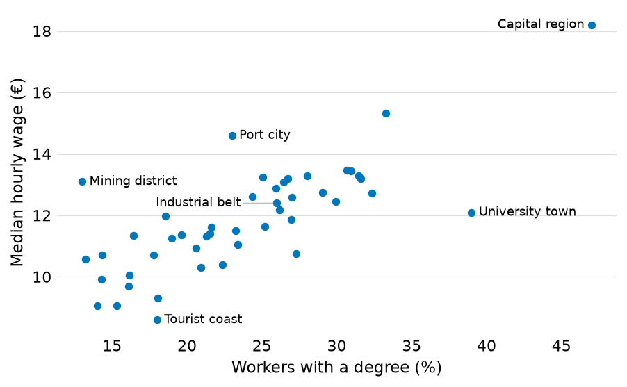
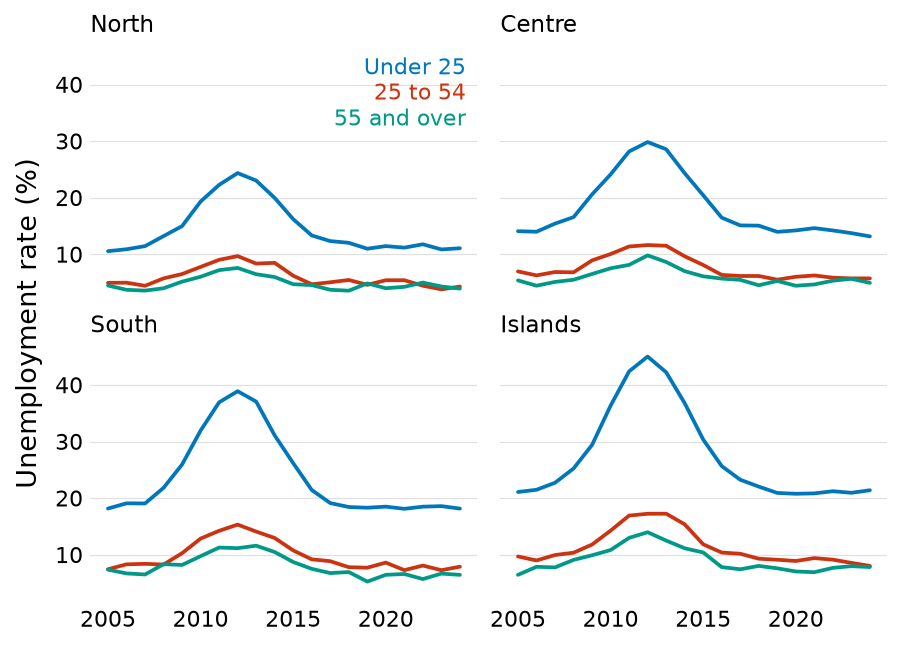

# figtools

figtools is a matplotlib style with helpers for the figures of research
papers and slides, inspired by Kieran Healy's *Data Visualization* (hat tip
to Paul Goldsmith-Pinkham for
[the introduction](https://paulgp.substack.com/p/from-an-empty-folder-to-a-figure)).
It does four things:

- **Direct labels.** Each series is named at its end, in its own colour,
  instead of in a legend, and the labels place themselves clear of one
  another and of the data at whatever size the figure is drawn.
- **A check that no label collides with anything.** `collisions(fig)`
  measures the drawn figure and reports any label on a line, a marker, a
  shape or another label, and any text cut off at the edge. `save` refuses
  to write such a figure, and `fig-check` checks every figure in a folder
  of documents.
- **Figures at the size of their destination.** `save` writes each figure
  at the exact width of a paper's text column and of a slide, so its type
  lands on the page at the point size `setup` chose.
- **Figures that lead back to their data and code.** Beside each figure it
  saves, `save` writes a plain-text companion holding every value the
  figure plots and the line of code that saved it, so a figure found
  anywhere leads back to both, and a change to a figure shows as a diff in
  version control. After a Quarto render a hook writes each document's
  figures, tables and printed output as text, so a script or a language
  model working from a paper's figures or a rendered document reads the
  values each figure shows. No figure file carries any of this, so neither
  does a paper or a page that includes one. The values include every
  plotted point, a scatter's raw observations among them, so for
  confidential data turn them off with `ft.setup(digest=False)`.

These make figtools suited to coding agents. An agent can look at a
rendered figure, but each look is costly, approximate and not always the
same; the check gives it an exact pass or fail to work towards, and the
digest the exact values a figure shows
([more below](https://github.com/fqueiro/figtools#working-with-coding-agents)).



*Synthetic data, drawn by [docs/readme_figure.py](https://github.com/fqueiro/figtools/blob/main/docs/readme_figure.py).*

## Install

```sh
pip install figtools
```

or, in a [uv](https://docs.astral.sh/uv/) project, `uv add figtools`.
figtools needs Python 3.11 or later, matplotlib and NumPy. The `fig-check`
command also reads YAML, and the `check` extra installs PyYAML for it:
`pip install "figtools[check]"`.

Pin the version in each project that uses figtools. The library decides
sizes, colours and label placement, so a new release can change how a
figure is drawn, and a pinned project changes its figures only when it
upgrades. A uv project pins the version in `uv.lock`; with pip, pin it
with `==` in the requirements file. The
[changelog](https://github.com/fqueiro/figtools/blob/main/CHANGELOG.md)
marks each change that alters figures.

## Quick start

```python
import matplotlib.pyplot as plt
import numpy as np

import figtools as ft

ft.setup()                                  # the style, once, before any figure

rng = np.random.default_rng(0)
years = np.arange(2000, 2025)
fig, ax = plt.subplots()
for region, growth in [('North', 1.5), ('Centre', 0.7), ('South', -0.4)]:
    y = 100 + growth * (years - 2000) + rng.normal(0, 1, len(years))
    ax.plot(years, y, label=region)
    ft.band(ax, years, y - 3, y + 3)        # in the colour of the line just drawn
ft.refline(ax, 100, '2000 level')           # a grey rule, named on the line
ax.set_ylabel('Employment (2000 = 100)')
ft.label_lines(ax)                          # each line named at its end
ft.save(fig, 'employment')                  # employment.pdf, employment_slides.pdf
```

`save` writes `employment.pdf`, 5.9 inches wide for a paper, and
`employment_slides.pdf`, 4.1 inches wide for a slide, and beside them
`employment.digest.txt`, the figure's values and the line of code that
saved it. Before writing each PDF it checks the figure at that size, and it
raises an error instead of writing a file in which a label overlaps
something. In a notebook the figure also appears below the cell.

`python -m figtools` prints a short usage guide, and `help(ft.label_lines)`
gives the full reference of any function.

## Gallery

Each figure is drawn from synthetic data by the script linked under it.
The scripts run with the tests, which fail if any label collides.

| | |
|:-:|:-:|
| <br>Time series with bands and a named reference rule ([script](https://github.com/fqueiro/figtools/blob/main/docs/gallery/time_series.py)) | <br>A period shaded and named in place ([script](https://github.com/fqueiro/figtools/blob/main/docs/gallery/shaded_period.py)) |
| <br>Event study with a zero rule and the treatment date ([script](https://github.com/fqueiro/figtools/blob/main/docs/gallery/event_study.py)) | <br>Coefficient plot, ranked ([script](https://github.com/fqueiro/figtools/blob/main/docs/gallery/coefficient_plot.py)) |
| <br>Dumbbell: two measurements per row, told apart by fill ([script](https://github.com/fqueiro/figtools/blob/main/docs/gallery/dumbbell.py)) | <br>Binned scatter net of a control, with the fitted slope ([script](https://github.com/fqueiro/figtools/blob/main/docs/gallery/binned_scatter.py)) |
| <br>Scatter in which each name is the mark ([script](https://github.com/fqueiro/figtools/blob/main/docs/gallery/labelled_scatter.py)) | <br>A few points named, each label clear of every point ([script](https://github.com/fqueiro/figtools/blob/main/docs/gallery/named_points.py)) |
| <br>Small multiples with the series named once ([script](https://github.com/fqueiro/figtools/blob/main/docs/gallery/small_multiples.py)) | |

## Direct labels

A legend makes the reader hold a colour in memory and move back and forth
between the key and the data; a name at the end of each line does not.
`label_lines` puts the names in the margin beyond the panel, moves them
clear of one another and of the lines, and draws a hairline leader back to
a line once its label has moved far enough that the pairing stops being
obvious. `setup` turns on matplotlib's constrained layout, which measures
the margin the labels need and shrinks the axes to fit, so the panel ends
where the data end and the grid stops with it. A `tight_layout()` call on
such a figure warns and switches the layout engine off. A label wider than
a fifth of the figure is broken at spaces into two or three balanced
lines, decided again at each output size; a label broken by hand, with a
newline, is kept as written.

Where line ends crowd, as in small multiples, `key` stacks the names in a
free corner, each word in its series' colour. `label_points` names some
points of a scatter, each name moved clear of the others, of the points and
of the lines; `label_scatter` prints names as the marks themselves.
Reference rules and shaded periods are named in place too: an unlabelled
rule at 0 or 1 leaves the reader to work out what it marks, so `refline` and
`shade` write the name on the rule or the band, where the data leave room.

## Checking figures

Direct labelling fails silently: a label on a line or on another label
still renders and raises nothing. `collisions(fig)` draws the figure and
measures it. It returns one `(panel, kind, description)` tuple per problem,
and an empty list when the figure is clean. The kinds are
`'label/label'`, `'label/line'`, `'label/marker'`, `'label/shape'`,
`'label/outside'` (a rule's label outside its panel) and `'text/edge'`
(text that runs off the figure). It measures every piece of text, a legend
or a key built from offset boxes counting as one label, against other
text, plotted lines, scatter markers at their drawn size and the outlines
of filled shapes such as bars, arrows and bands. Reference rules and shaded
periods are furniture that any label may cross. A label may sit inside a
shape or clear of it, but not across its edge unless it is pinned in the
shape, as a value written at the end of its bar is. The names
`label_scatter` prints may overlap one another, since they are the
observations, but any other label over one of them is reported. The
placement helpers steer clear of everything the check measures; the check
catches what they could not resolve and what was drawn by hand.

In a script, `assert not ft.collisions(fig)` stops on a bad figure. `save`
runs the check at each size it writes and raises instead of writing a
figure whose labels collide or whose text is cut off at the edge, so a bad
figure never reaches the disk.

`fig-check` checks every figure in a folder of documents without rendering
them. It runs each document's code as Quarto or Jupyter would (the `# %%`
cells of a percent-format `.py`, the Python chunks of a `.qmd`, the code
cells of a `.ipynb`), in the folder Quarto runs it in, and measures each
figure at the size an HTML render gives it, read from `fig-width` and
`fig-height` as Quarto reads them (7 by 5 inches when nothing sets them).
A `.py` file counts as a document when it has a `# %% [markdown]` or
`# %% [raw]` cell. A figure the document saves with `save` is measured at
each size and not written, so a check leaves the document's figure files as
they were. It needs the `check` extra.

```sh
fig-check docs                  # every document in docs/
fig-check docs report           # one document, by stem or file name
fig-check docs --figs figures   # also write each figure as a PNG
```

Every document is checked, even after one fails. The exit code can gate a
commit or a CI job:

- 0: every figure is clean.
- 1: some document has overlaps, and none crashed.
- 2: some document raised an error, whose traceback is printed, or the
  check could not start (wrong arguments, or PyYAML missing).

## A figure's data and code, beside it

Each call to `save` writes, beside the PDFs, one plain-text companion:
`save(fig, 'results/figures/employment')` writes `employment.pdf`,
`employment_slides.pdf` and `employment.digest.txt`, which reads

```text
figure: employment
source: ../../code/employment.py:23
file: employment.pdf, 5.9 x 4.425 in
file: employment_slides.pdf, 4.1 x 3.075 in
digest: every plotted value, one per line, to six significant digits; tab-separated columns

panel 1
x: (number)
y: Employment (2000 = 100) (number)

series 1: North (line, #0077bb)
x	y
2000	100.2
2001	101.4
...

reference line: y = 100 "2000 level"
```

The `source:` line gives the file and line of the call to `save`, the file
relative to the companion's folder. Below the `file:` lines comes the
figure's
[digest](https://github.com/fqueiro/figtools#the-digest):
each panel's axes, each series with every value it plots, one row per
line, and the panel's reference lines, shaded periods, named points and
notes.

A figure found anywhere, in a paper's figure folder or attached to an
email, thus leads back to its data and to the code that drew it. The
companion is a text file, which any editor reads without figtools;
`render-digest figure employment_slides.pdf` prints the companion of a PDF
or of one of its variants. An editor can follow the source line from a
figure in a paper to the line that saved it.

In version control, track the companions and ignore the PDFs. A change to a
figure then shows as a diff of the values it plots, which can be reviewed
line by line, while the binary PDFs stay out of the history. The text is
deterministic: it holds no time, values keep six significant digits, and
every list keeps the figure's own order, so rerunning unchanged code gives
the same bytes. `save` rewrites the companion only when its text changes
other than in the line number of the call. Code moved within its file would
otherwise change the companion of every figure saved below the move,
though no figure looks different; the recorded line is therefore where the
call was when the figure last changed, and an editor following it should
look near it. `save` writes the companion on every call, also when it finds
the PDFs current, so a deleted or stale companion comes back.

The caller is the first stack frame outside figtools. A notebook kernel,
which is how Quarto runs a percent script or a `.qmd`, compiles each cell
under the name of a temporary file and counts its lines from the cell's
top, so `save` looks for the document whose lines hold the cell's lines as
one block, and adds the line within the cell to where the block starts. The
document searched is the one Quarto names when it renders, or else every
`.py` and `.qmd` in the kernel's working directory. A wrong record is worse
than none: a cell found in no document or in two places, or code run from a
string, gets no `source:` line. A relative path holds when the project
moves or syncs to another machine with its figures and code together; where
none exists, as across two drives, the path is absolute.

No document that includes a figure carries anything figtools wrote. A
PDF's one figtools entry is the fingerprint `save` compares to leave a
current file alone
([below](https://github.com/fqueiro/figtools#figures-at-the-size-of-their-destination)),
and it sits in the PDF's document catalog: pdfLaTeX and LuaLaTeX copy an
included PDF's document information into the paper, but no LaTeX engine
copies its catalog. A figure a notebook displays carries nothing either,
its digest going into a store outside the project, so a self-contained
HTML page, which embeds its images, holds the pixels and nothing more.

The companion holds the plotted values, so a repository that tracks it
publishes them. For figures of confidential data,
`ft.save(fig, path, digest=False)`, or `ft.setup(digest=False)` for every
figure, leaves in the companion the source and file lines and a line
saying the digest is off.

## The digest

A figure is a picture of data that a program cannot read back. figtools
reads each figure into a *digest*: for each panel, the axis titles, scales
and kinds; each series with its label, colour and values (lines, markers,
bars, scatters, bands, intervals, error bars); the reference rules and
shaded periods with their names; named points; and notes. The digest of a
figure `save` writes goes into its companion. That of a figure a notebook
kernel (Jupyter, VS Code's interactive window, a Quarto render) displays
after `setup()` goes into a store outside the project,
`~/.local/share/render-digests/_figures/`, under the sha256 of the image's
bytes: the kernel displays the image as matplotlib drew it, PNG, JPEG, SVG
or PDF, and a rendered page holds the same bytes, embedded or linked, so
each of its figures finds its digest again. Terminal IPython runs no
kernel, and there `setup` leaves the display alone.

**The digest holds the data.** It holds every plotted point, raw
observations of a scatter included (up to 5,000 points per series in the
store; a companion keeps them all), and anyone who has the companion or the
store can read them back. A binned or aggregated figure holds only the
aggregates it plots. For figures of confidential data, turn the digest off:
`ft.setup(digest=False)` for every figure, or
`ft.save(fig, path, digest=False)` for one figure's companion.

The digest is on by default. To read one back:

```sh
render-digest figure results/fig1.pdf
```

prints the companion of a PDF `save` wrote, or, for a PNG, JPEG, SVG or PDF
a kernel displayed, such as a figure saved from a rendered page, the digest
the store holds for it, as markdown tables. `describe(fig)` in
`figtools.digest` returns the digest of a live figure.

With Quarto, a post-render hook collects the digests after each render. In
the project's `_quarto.yml`:

```yaml
project:
  post-render: python -m figtools.digest post-render
```

For each rendered document the hook writes a folder holding `outputs.md`
(the headings, each figure's values as tables, the page's tables as
markdown and its printed output as code blocks, in document order), one CSV
and one image per figure, and a manifest with the render time and a hash of
the source. The folder is
`~/.local/share/render-digests/<project folder>/<document path>/`, outside
the repository; the environment variable `FIGTOOLS_DIGEST_DIR`, set to an
absolute folder, moves the root, the store with it. The manifest records
the project's path, and the hook refuses to overwrite the digest of another
project with the same folder name while that project's folder still holds
its `_quarto.yml`; give one of them its own root. The digest of a project
that has moved or been deleted is stale, and the next render replaces it.

A document rendered to PDF has its figures' digests written under `pdf/` in
the same folder. Quarto deletes a PDF render's figure files once LaTeX has
included them, so no image is left to look up; in a Quarto render of a
document inside a project, the kernel therefore also records each figure it
displays as PDF, in drawing order, with a hash of the document's source.
The hook takes the newest render of the source as it now stands, numbers
its figures in the order the document draws them, and removes the
document's older renders. A render is told from the next by a name the
kernel keeps in the notebook's namespace, which Quarto clears at the start
and the end of each execution, also in a kernel its daemon keeps between
renders.

- `render-digest where <document>` prints the folder of a document.
- `render-digest check <document>` exits 0 when the digest matches the
  source, 1 when the source has changed since the render, and 2 when there
  is no digest or the digest belongs to another project that still exists.
- `render-digest prune [<project folder>]` lists the digests of documents
  and projects that no longer exist, the store's entries neither written
  nor read in 30 days and, given a project folder, the companions in it
  none of whose PDFs exists; it removes them once you confirm (`--yes`
  skips the question) and prints what it removed.

The first two exit 2 with a message when the document lies in no Quarto
project.

The hook reads the paths Quarto passes in its environment, so it runs from
a Quarto render only. It finds each output's source at the same path under
the project folder as the output has under the output folder (`output-dir`,
a website's `_site`, a book's `_book`), and reads each figure from the
page, embedded in it or linked in the `<document>_files` folder Quarto
writes beside it, so the page need not embed its resources. It skips, with
a line saying why, a page made from plain Markdown (`.md`), which runs no
figtools code, and a PDF that no single document made, such as a book's.
It fails the render when an output has two sources among `.py`, `.qmd` and
`.ipynb`, or a page has none at all, and, naming the figure, when a figure
lost its caption to another output of its cell.

Limits, each stated in the digest itself: a series longer than 5,000
points is thinned evenly in the store; a large image grid is given by its
shape and range only; colour or size that varies point by point is not
decoded. A markdown table over about 600 cells is thinned to its first,
last and extreme rows and says so, while the CSV keeps every row. Calling
`set_matplotlib_formats` after `setup()` replaces the formatters that file
the digest; call `setup()` again after it. In a PDF render, a figure the
document draws but hides (`output: false`) takes a number though the PDF
does not show it, a notebook that runs `%reset` itself splits its render in
two, and figures displayed in a format other than PDF (`fig-format: png`)
get no digest.

## Working with coding agents

A coding agent can look at a rendered figure, but each look costs time and
tokens, can miss a small overlap, reads values only approximately, and may
not give the same verdict twice. figtools gives it exact, repeatable
answers instead, and leaves looking for what no check measures, such as
whether a figure reads well:

- `python -m figtools` prints a short usage guide matching the installed
  version, written to be read before writing figure code. One line in a
  project's `AGENTS.md` or `CLAUDE.md` points an agent at it:

  ```md
  Before writing figure code, read the output of `uv run python -m figtools`.
  ```

- `collisions`, `save` and `fig-check` turn "is this figure readable?" into
  a check with an exit code, so an agent fixes overlaps until the check
  passes, without looking at the figure after every change.
- The digest lets an agent read the numbers a figure shows, from a saved
  figure's companion or from a render's `outputs.md`, so the prose it
  writes about a figure rests on the figure's values rather than on values
  read off its pixels, and the companion's source line takes it to the code
  that drew the figure.
- Errors name the function and the fix, which an agent can act on
  directly.

## Figures at the size of their destination

`save` renders each file at the physical width of where it goes, 5.9
inches for a paper's text column and 4.1 inches for a slide by default,
re-solving the label placement at each size. Include the PDFs in LaTeX at
their natural size, with no `width=` option: the type then lands on the
page at the point size `setup` chose. Scaling a figure when it is included
is what changes the size of its type. Each file is written whole,
uncropped, so figures built alike come out the same size and subfigures
stacked in a paper line up; the usage guide gives the recipe for figures
read at one scale. Other destinations are a width away:
`save(fig, path, widths={'poster': 9.0})` also writes `path_poster.pdf`.

Rerunning a document rewrites only the figures that changed. Drawing,
checking and writing each PDF is most of what `save` costs, about 16 of
the 17 seconds a 17-figure document spends in it, and a rewritten file
also looks new to LaTeX, to version control and to a file sync. So each
PDF carries a fingerprint, in its document catalog, of what it was drawn
and written from: the figure itself, read from its pickle, with every
artist, value, colour, font setting and size in it; the rcParams; the
fonts matplotlib can find; the matplotlib and figtools versions; the
target, its width and the digest choice; and the file that called `save`,
but not the line, so code moved within its file leaves the PDF as it is.
A PDF whose fingerprint matches is current and is left as it is, without
the check, which it passed when it was written. A change to any of those
writes the file again. A figure that cannot be pickled, as one with a
lambda tick formatter, has no fingerprint and is written every time; a
named function in its place gives it one. A font file replaced on disk
under the same name is the one change to how a figure is drawn that the
fingerprint does not see. The fingerprint depends on the fonts of the
machine that drew the figure, which is why it stays in the PDF, which
version control ignores, and out of the companion.

## The style, and what the helpers assume

Each choice below is something the helpers assume. A figure that departs
from one still draws, but its labels and its check may not behave as
described.

**One palette in a fixed order.** Paul Tol's vibrant scheme, which readers
with colour-blindness can tell apart, with black in place of its grey:
seven colours, which series receive in the same order in every figure.
Up to four series, the colour alone identifies each; past four, the labels
carry the identification. Since a label names its series by colour,
`label_lines` raises an error when two lines it would name cannot be told
apart by colour, line style and marker, as happens to the eighth series of
an unstyled plot. A `key`'s colours are chosen by hand, and its entries may
share a colour when their words tell them apart. Grey is kept for
everything that is not data: rules, the grid, shaded periods, notes.

**No frame, and a grid on the measured axis only.** There are no spines and
no tick marks: the grid and the tick labels give the reader every
reference needed, and a frame is ink that carries no data. The grid is
light, sits behind the data, runs along the axis that carries the
measurement only (horizontal lines for a time series, vertical ones for a
dot plot), and stops where the data stop.

**Ticks at values the data can take.** Where everything plotted against an
axis is a whole number, so are its ticks. Matplotlib's default steps
include 2.5, which labels a sixteen-year axis 2007.5, 2010.0, 2012.5, and
whether a panel lands on that step depends on how much margin its labels
take, so one longer series name can flip it. An axis of fractional data
keeps its fractional ticks; a reference rule at 2020.5 is furniture and
does not count as data.

**Dots instead of bars.** Where a figure compares magnitudes across
categories, `dotplot` draws a Cleveland dot plot. A bar spends ink on the
length from zero, which misleads when zero is not a meaningful origin; a
dot marks the value alone.

**Type from one base size.** `setup(base=11)` puts titles and axis labels
at the base size and every other piece of text (ticks, line labels, key
entries, notes) half a point below it. The one exception is the names that
`label_points` and `label_scatter` print at scatter points, two points
smaller again so that many of them fit in the panel. Every helper reads its
sizes from the base, so sizes cannot drift apart element by element, and a
slide deck is `setup(base=13)` rather than a retouching session. The
default of 11 points is ggplot's base size.

**The caption carries the quantity.** The helpers assume that the caption
names the quantity, its unit and its sign convention, and that each
reference rule is named on its line, so the axes carry no title that
repeats them. A title is kept where the ticks alone would mislead, as on a
scatter whose two axes are different variables.

**Limits left to autoscale.** A helper moves an axis limit only while that
limit autoscales: `label_lines` ends the panel at the data, and a rule's
label at the top of the data raises the top to fit. A limit set by hand,
such as a scale shared across figures, is never moved. A rule's label that
then does not fit on its usual side goes to the other side of the rule, or
stays outside the panel for the check to report.

**A captioned figure cell shows the figure and nothing else.** In a Jupyter
or Quarto document, a cell displays the value of its last statement when
that statement is an expression. A bare matplotlib call such as
`ax.set_xlabel(...)` returns an object that is then displayed as a second
output, and so is a table. Quarto numbers the figure and that output as
subfigures (a) and (b), gives the caption to the second output, and leaves
the figure without one. The drawing helpers and `save` return values that
a notebook displays as nothing, so a cell may end on one of them; `panels`
and `collisions` return values a notebook shows. End any other figure cell
with `plt.show()`, and give tables cells of their own. The digest's Quarto
hook fails the render and names any figure whose caption another output
took over.

**`setup` changes the whole process.** It sets matplotlib's rcParams
globally, replaces the linear scale with one that applies the whole-number
tick rule to every axes created afterwards by any library, and in a
notebook kernel wraps the formatters that display figures. Code that shares
a process with other plotting can use `with ft.style():` instead, which
applies the same inside the block and undoes it on leaving.

**Data in any array form.** The helpers convert their data with
`np.asarray`, so lists, NumPy arrays, pandas Series and Polars columns all
work as they are.

## Public names

| Name | What it is |
|---|---|
| `setup(base=11, digest=True)` | Applies the style to the whole process. Call it once, before any figure. |
| `style(base=11, digest=True)` | The same as `setup` inside a `with` block, undone on leaving. |
| `label_lines(ax)` | Names each line at its end, in its colour, in the margin. Call it once per axes, after every series. |
| `label_points(ax, x, y, labels)` | Names some points of a scatter, each label moved clear of the others, of the points and of the lines. |
| `label_last(ax, x, y, text, color)` | One direct label, for a series drawn without a line. |
| `key(ax, entries)` | Coloured names stacked in a free corner, for small multiples or crowded line ends. |
| `refline(ax, value, label=None, axis='y')` | A grey reference rule, horizontal or (with `axis='x'`) vertical, named on the line. |
| `shade(ax, x0, x1, label=None)` | A shaded range of x, named at its top. |
| `refcurve(ax, x, y)` | A grey background curve (a fit, a 45-degree line, a bound) that labels may cross. |
| `band(ax, x, lo, hi)` | A confidence band in the colour of the line drawn just before. |
| `pointrange(ax, x, y, lo, hi)` | Estimates with vertical intervals, for event studies and coefficient profiles. |
| `dotplot(ax, labels, values, ci=None)` | A Cleveland dot plot ranked by value; with `ci`, a horizontal coefficient plot. |
| `binscatter(ax, x, y, controls=None, bins=20)` | Means of y within quantile bins of x, with an OLS fit on every observation. Returns the bin means and the slope. |
| `label_scatter(ax, x, y, labels)` | A scatter whose marks are the names, with an optional fit line and a note giving N and R². |
| `panels(n=2)` | A row of `n` panels sized as one figure. Returns `(fig, axes)`. |
| `grid_axis(ax, axis)` | Draws the grid on `'x'`, `'y'` or `'both'` only. |
| `collisions(fig)` | Lists each label that overlaps something and each text that runs off the figure. Empty when the figure is clean. |
| `save(fig, path)` | Writes `path.pdf` and `path_slides.pdf` at their exact widths, and beside them `path.digest.txt` with every plotted value and the file and line that called `save`; refuses any size at which the check fails; leaves a PDF already drawn from the same figure as it is. Returns the PDFs' paths. |
| `load(path)` | Reopens a figure pickled by `save(..., retouch=True)`, and raises for a pickle that any other figtools version wrote. Unpickling runs code from the file: load only files you wrote. |
| `PALETTE` | The seven colours, in the order series receive them. |
| `GREY` | The greys for rules, the grid, notes and shaded periods. |
| `TARGET_WIDTHS` | The widths `save` writes, in inches: `{'paper': 5.9, 'slides': 4.1}`. `save(..., widths={'poster': 9.0})` also writes `path_poster.pdf`, and `widths={'paper': 6.2}` overrides a default. `targets=` chooses the files, and must name every target `widths` gives. |
| `BASE_SIZE` | The default base type size, 11 points. |
| `__version__` | The installed version. |
| `figtools.digest` | Reads and writes the digest; `describe(fig)` returns a live figure's digest, `find_companion(pdf)` the companion of a saved figure. |
| `fig-check` | The command that checks every figure in a folder of documents. |
| `render-digest` | The command that reads digests back, runs the Quarto hook and prunes stale digests. |
| `python -m figtools` | Prints the usage guide; `python -m figtools readme` prints this README. |

The drawing helpers return what they drew (lines, labels, bands, markers)
in a list, so that it can be restyled; `rule, label = ft.refline(ax, 0,
'zero')` is a typical use. A notebook displays the list as nothing.

## Versions and changes

Until version 1.0, a minor release (0.8 to 0.9) may change the interface
and how figures are drawn. The
[changelog](https://github.com/fqueiro/figtools/blob/main/CHANGELOG.md)
lists each release's changes, marks those that alter figures, and gives the
steps to upgrade. Read it before upgrading a pinned project, and compare the
figures after.
[CONTRIBUTING.md](https://github.com/fqueiro/figtools/blob/main/CONTRIBUTING.md)
covers the tests and the release steps.

## License

MIT; see [LICENSE](https://github.com/fqueiro/figtools/blob/main/LICENSE).
